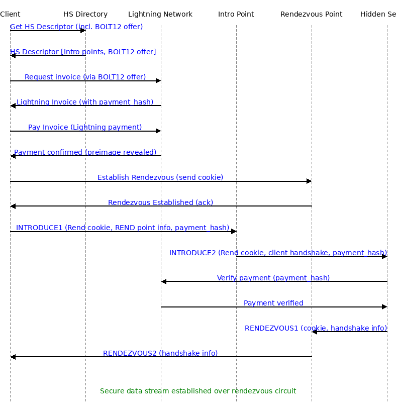

> **Historical material — not current protocol requirements.** Retained for provenance; use the [current specification](../index.md). Claims, diagrams and examples here may conflict with the current draft or describe older implementation experiments.

## Detailed architecture and protocol requirements

### How to pay for a Rendezvous Circuit (Tor Hidden Service + Lightning Network)

**Overview:** The diagram below shows a UML-style sequence of interactions between a Tor **Client**, a **Hidden Service** (HS), an **Introduction Point** (Intro), a **Rendezvous Point** (RP), and the **Lightning Network**, implementing a *paid rendezvous circuit*. In this scenario, the hidden service requires the client to pay via Lightning before granting access. The sequence covers retrieving the HS descriptor (with a BOLT 12 Lightning offer), completing a Lightning payment, and then the usual Tor hidden service rendezvous handshake (INTRODUCE1/2 and RENDEZVOUS1/2 cells) with the payment proof integrated. All Tor protocol cell types (e.g. `INTRODUCE2`, `RENDEZVOUS1`, etc.) and payment-related messages are annotated in the diagram.

*Figure: UML Sequence Diagram of a paid Tor hidden service rendezvous, involving Lightning Network payment. The client pays the hidden service (via a BOLT12 offer/Lightning invoice) before the hidden service will complete the Tor rendezvous handshake. Tor cells like `INTRODUCE1/2` and `RENDEZVOUS1/2` are shown in bold text, and the payment flow is included on the left side.*

**Design status:** This is a proposed El Tor extension, not a description of standard Tor or a completed implementation. The four revision requirements below refine the payment and authorization flow. The existing diagram is conceptual; it does not yet show client-bound authorization, circuit/round funding, retry accounting, the bounded free introduction allowance, or the new introduction-point quote return path. Paid circuits use one-minute rounds and an initial ten-round payment period. The renewal draft below allows that same paid circuit to continue only through negotiated, funded extensions; it does not claim implemented renewal support. The Service Circuit Quote (SCQ) below defines the fixed pricing agreement for the service-to-rendezvous circuit. Wire formats, padding durations, and free-capacity limits remain open design work.

The sequence below uses BOLT 12 as the recommended example. It does not require BOLT 12 or receiver-hiding paths; other mutually supported, verifiable payment methods are permitted under the payment-method policy below.

Below is a step-by-step breakdown of this sequence:

Before accepting a payable SCQ or initiating connection-specific paid work, complete the [El Tor version agreement](../onion-services/version.md#el-tor-service-version-agreement) through the [bounded introduction-point bootstrap](../onion-services/bootstrap.md#quote-bootstrap-through-the-introduction-point) below. Local version selection precedes the request; the authenticated SCQ response confirms it. Payment handling is mandatory in El Tor, including zero-fee cases; there is no optional-payment flag or ordinary-Tor compatibility mode in this protocol.

1. **Client Fetches Hidden Service Descriptor:** The client uses the onion address to query the Tor network’s distributed hash table (HS directory) for the hidden service’s descriptor ([Tor Project | How do Onion Services work?](https://community.torproject.org/onion-services/overview/#:~:text=it%2C%20so%20they%20connect%20to,descriptor%20of%20SecureDrop%27s%20Onion%20Service)). The descriptor is signed by the HS and contains a list of its introduction point addresses/keys ([Tor Project | How do Onion Services work?](https://community.torproject.org/onion-services/overview/#:~:text=And%20inside%20the%20descriptor%2C%20there,themselves%20to%20SecureDrop%27s%20Onion%20Service)). The HS descriptor also advertises its accepted payment methods and the information needed to request a Service Circuit Quote (SCQ) and obtain a fresh payment request. In this BOLT 12 example, it includes a Lightning **BOLT 12 offer** that the client can use to request a fresh invoice. The method list and invoice-acquisition mechanism must be authenticated with the service descriptor; exact encoding remains open.

2. **Service Circuit Quote and Invoice Request:** Before funding the service's path, the client selects its proposed rendezvous relay and a fresh client authorization key and requests an SCQ through the bounded introduction-point request/reply mechanism below, opening an eligible free introduction circuit before payment. Selecting the rendezvous relay does not require the service to construct its circuit. The service reads candidate relays' descriptors, selects a compatible private path, and quotes the combined per-minute relay cost plus disclosed setup and routing-fee budgets. The client may reject the quote without authorizing paid work by the service. If it accepts, it obtains an initial-round invoice bound to that SCQ, circuit authorization identifier, and client key. In the BOLT 12 example, the advertised offer is used to request a fresh invoice through Lightning; other methods follow their negotiated invoice-acquisition mechanism. Quote delivery, acceptance, and invoice binding remain wire-protocol work. An invoice request or dummy handshake value alone does not authorize service-side spending.

3. **Client Pays Invoice (Lightning Payment):** The client’s Lightning wallet routes the payment through the Lightning Network to the hidden service’s node. Upon successful payment, the hidden service’s Lightning node receives the funds and, as per the Lightning protocol, releases the secret preimage associated with the invoice’s `payment_hash` ([How to prove that a lightning invoice was paid? | Blink FAQ](https://faq.blink.sv/blink-and-other-wallets/how-to-prove-that-a-lightning-invoice-was-paid#:~:text=,was%20included%20in%20the%20invoice)). The preimage travels back to the client as proof of payment. At this point, the payment is complete – the client knows the payment succeeded (having received the preimage), and the hidden service knows it has been paid. The client retains the `payment_hash` and the preimage returned on settlement; the preimage cannot be derived from the hash. These identify and demonstrate payment, but do not by themselves authenticate the connecting client. Before payment, the service must associate the invoice with a fresh client authorization key and agreed terms, for the intended circuit and initial round, as described in revision 1 below.

4. **Client Establishes a Rendezvous Point:** In parallel with the payment (or afterward), the client prepares for the Tor connection. It uses the **rendezvous point (RP)** selected for the accepted SCQ. The client builds a 3-hop Tor circuit to that relay and sends a `RELAY_COMMAND_ESTABLISH_RENDEZVOUS` message to designate it as the RP ([Tor Project | How do Onion Services work?](https://community.torproject.org/onion-services/overview/#:~:text=Before%20the%20introduction%20takes%20place%2C,part%20of%20the%20rendezvous%20procedure)). This message contains a randomly generated 20-byte **rendezvous cookie** that will serve as a shared secret for linking circuits ([The rendezvous protocol - Tor Specifications](https://spec.torproject.org/rend-spec/rendezvous-protocol.html#:~:text=The%20client%20sends%20the%20rendezvous,byte%20value)). The rendezvous point stores this cookie and replies with a `RENDEZVOUS_ESTABLISHED` acknowledgment (confirming it’s ready) ([torspec/rend-spec-v3.txt at main · torproject/torspec · GitHub](https://github.com/torproject/torspec/blob/main/rend-spec-v3.txt#:~:text=39%20)). At this stage, the RP is “parked” waiting for the hidden service to connect with the same cookie; it does not yet know which HS will connect.

5. **Client Builds Introduction Circuit:** For the funded connection, the client reuses its still-eligible bootstrap introduction circuit or opens a new Tor circuit to one of the hidden service’s **introduction points** listed in the descriptor. This is also a 3-hop anonymized circuit terminating at the chosen intro point. (The HS is already connected to this intro point via its own long-lived circuit.) Now the client has two circuits in place – one to the RP and one to the Intro point – and has paid the required Lightning invoice. The client is ready to introduce itself to the HS.

6. **Client Sends `INTRODUCE1` (with Rendezvous Info & Payment Authorization):** Over the intro circuit, the client sends an **`INTRODUCE1`** cell to the introduction relay, requesting introduction to the HS ([torspec/rend-spec-v3.txt at main · torproject/torspec · GitHub](https://github.com/torproject/torspec/blob/main/rend-spec-v3.txt#:~:text=34%20)). This cell (encrypted to the HS’s service key) contains: the rendezvous cookie generated in step 4, the identity of the chosen rendezvous point, the client’s ephemeral key and other handshake data, **and a compact payment authorization** referencing the invoice and proving possession of its bound client authorization key. The authorization covers this connection attempt, including its rendezvous details, as described in revision 1; a payment hash alone is not an access credential. The introduction point then forwards this to the hidden service over the HS’s intro circuit as an **`INTRODUCE2`** cell ([torspec/rend-spec-v3.txt at main · torproject/torspec · GitHub](https://github.com/torproject/torspec/blob/main/rend-spec-v3.txt#:~:text=35%20)). In essence, the intro point “introduces” the client to the HS by delivering the client’s rendezvous details and payment proof. The hidden service receives the INTRODUCE2 message (containing the rendezvous cookie, RP address and payment authorization) ([Tor Project | How do Onion Services work?](https://community.torproject.org/onion-services/overview/#:~:text=The%20introduction%20point%20passes%20your,whether%20you%27re%20trustworthy%20or%20not)).

7. **Hidden Service Verifies Payment and Reserves Round Funding:** Upon receiving `INTRODUCE2`, the HS verifies the client-bound authorization and checks its own Lightning node's invoice records through a synchronized local ledger. The invoice must have been issued by this service for the accepted SCQ, agreed payment method, offer where applicable, circuit/round amount, and terms, and must be settled. When the authorization supplies a preimage, the service checks that its SHA-256 hash equals the invoice's `payment_hash`; a matching pair without the service's settled invoice record is insufficient. The service then atomically reserves the settled funding assigned to this circuit's initial round, including any agreed setup costs, before constructing a paid circuit. Invalid, expired, unpaid, or replayed authorizations do not trigger paid circuit construction. Wallet synchronization happens asynchronously rather than through a blocking wallet RPC in the Tor handshake. `INTRODUCE_ACK` is sent by the introduction point to report introduction delivery; it is not confirmation that the service accepted payment. Service-level rejection/status signaling still needs an explicitly defined protocol.

8. **Hidden Service Builds Circuit to Rendezvous Point:** The hidden service now initiates the rendezvous from its side. Using the round funding reserved in step 7, the HS selects and pays its own relays and creates a new 3-hop Tor circuit out to the chosen rendezvous point (using the rendezvous address provided by the client in the INTRODUCE2 message). Once this circuit to the RP is established, the hidden service sends a **`RENDEZVOUS1`** cell to the rendezvous point over that circuit ([torspec/rend-spec-v3.txt at main · torproject/torspec · GitHub](https://github.com/torproject/torspec/blob/main/rend-spec-v3.txt#:~:text=36%20)). This message includes the same 20-byte rendezvous cookie (received via the intro point) and the HS’s part of the handshake (encrypted with the client’s public key from the introduction handshake). By sending RENDEZVOUS1, the HS is effectively saying “I am the hidden service that the client is trying to reach, here is the cookie to match and my handshake data.” The rendezvous point, upon seeing the cookie, recognizes it from step 4 and knows this HS corresponds to the waiting client connection.

9. **Exchanging `RENDEZVOUS1/2` and Completing Handshake:** When the HS’s RENDEZVOUS1 cell arrives at the rendezvous point, the RP links together the two circuits that share the same cookie (the client’s circuit from step 4 and the HS’s circuit from step 8). It then forwards the HS’s handshake data to the client by sending a **`RENDEZVOUS2`** cell down the client’s rendezvous circuit ([torspec/rend-spec-v3.txt at main · torproject/torspec · GitHub](https://github.com/torproject/torspec/blob/main/rend-spec-v3.txt#:~:text=37%20)). The RENDEZVOUS2 carries the hidden service’s encrypted handshake information to the client. The client’s Tor instance receives RENDEZVOUS2 and completes the cryptographic handshake (e.g. finishing the ntor key agreement using the HS’s public key in the handshake) ([Tor Project | How do Onion Services work?](https://community.torproject.org/onion-services/overview/#:~:text=The%20Onion%20Service%20connects%20to,been%20relayed%20through%20the%20service)). At this point, the rendezvous is established: the client and HS now have a shared session key, and the two Tor circuits are joined at the RP. (The rendezvous point has verified the cookie from both sides matched, and it will simply pass traffic between the client and HS from now on.)

10. **Rendezvous Circuit Established – Data Flows:** The client and hidden service now have an end-to-end encrypted channel through the rendezvous point. The Tor rendezvous handshake is complete, and a secure Tor circuit spans from the client to the HS (consisting of 3 hops from the client to RP, plus 3 hops from the HS to RP) ([Tor Project | How do Onion Services work?](https://community.torproject.org/onion-services/overview/#:~:text=Act%209%3A%20Where%20the%20Onion,Service%20rendezvous%20with%20the%20client)). The rendezvous point does not learn anything about the data or identities; it only knows the cookie used to connect the circuits. At this stage, the client can begin communicating with the hidden service (for example, sending an HTTP request if the HS is a web server). All data (the “secure data stream”) is tunneled through the rendezvous circuit – encrypted end-to-end between the client and HS and relayed by the RP. The hidden service has successfully received payment prior to communication, and the client and HS now communicate over the paid rendezvous circuit as they normally would over any Tor hidden service connection.
